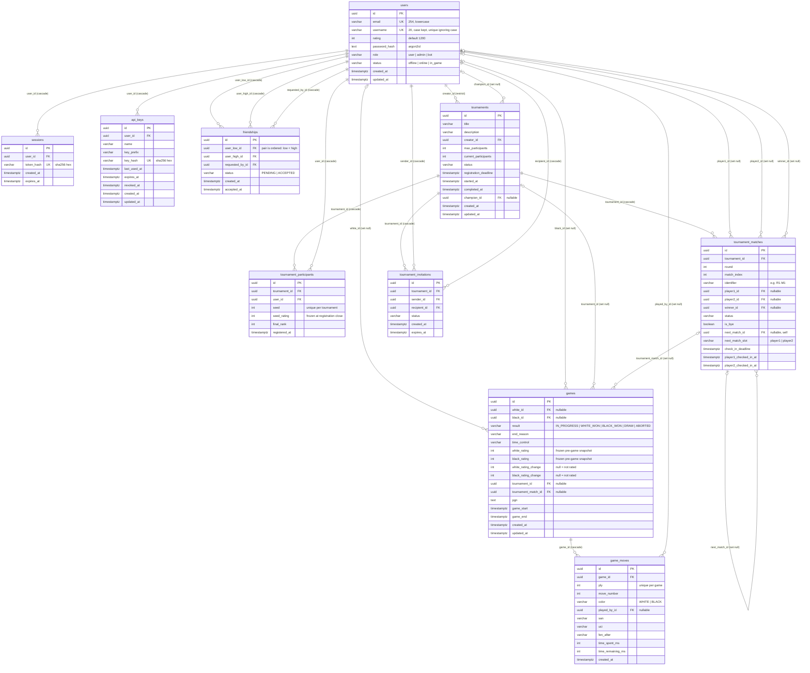
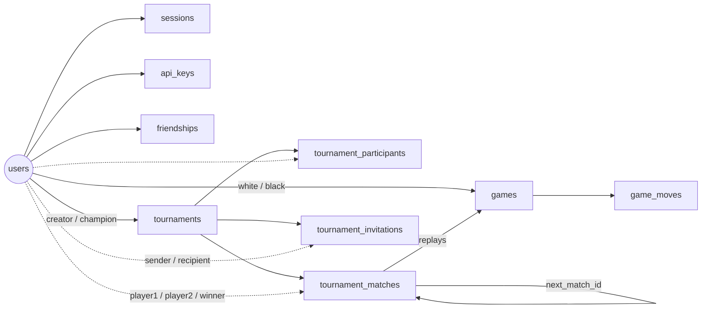

# Database Schema & Relations

All 10 tables and their foreign keys, from `backend/prisma/schema.prisma` and the SQL migrations in
`backend/prisma/migrations/` (latest: `20261110120000_username_case`). Names are the real PostgreSQL names
(`@@map` / `@map`), not the Prisma model names. Roles, setup and migrations: [database-setup.md](database-setup.md).

The diagrams are Mermaid, GitHub renders them directly.

## 1. ER Diagram

**How to read it:** `||--o{` means one to zero-or-many with a required FK. `|o--o{` means the FK is nullable.
The label is the FK column and its `ON DELETE` rule.

## 2. Overview

The same relations without columns:

## 3. What Happens on Delete

| Deleting a… | Effect |
| :--- | :--- |
| **user** | Their sessions, API keys, friendships, tournament entries and invitations are **deleted**. Their games, moves and tournament match slots **stay**, with the FK set to `NULL`, so other players keep their history. Blocked (`RESTRICT`) while they are the **creator** of any tournament. |
| **game** | Its `game_moves` are deleted. |
| **tournament** | Participants, matches and invitations are deleted. Its games stay, with `tournament_id` / `tournament_match_id` set to `NULL`. |
| **tournament match** | Matches pointing to it via `next_match_id` and its games get `NULL`. |

## 4. Keys and Rules Not Shown in the Diagram

**Unique**
- `users.email`, `sessions.token_hash`, `api_keys.key_hash`.
- `users_username_lower_key` on `lower(username)`: one username regardless of case (`Tom` blocks `tom`).
  It lives only in the SQL migration, `schema.prisma` can't express an index on an expression.
  See [account-settings.md](account-settings.md).
- `friendships (user_low_id, user_high_id)`: one row per pair, stored ordered (`friendships_order_check`).
- `game_moves (game_id, ply)`.
- `tournament_participants (tournament_id, user_id)` and `(tournament_id, seed)`.
- `tournament_matches (tournament_id, round, match_index)`.
- `tournament_invitations (tournament_id, recipient_id)`.
- Partial unique index `games_tournament_match_active_key` on `games(tournament_match_id)`: at most one live
  game per tournament match (SQL migration only).

**CHECK constraints** (in the SQL migrations, not in `schema.prisma`)
- `users`: canonical lowercase email, username `^[A-Za-z0-9_]{3,20}$`, role and status lists, non-empty password hash.
- `sessions` / `api_keys`: hash format (64 hex), expiry after creation.
- `friendships`: ordered pair, valid state, requester is one of the two.
- `games`: result list, `game_end >= game_start`.
- `game_moves`: color, `ply >= 1`, `move_number >= 1`, time spent `>= 0`.
- `tournaments`: title, participant bounds, status list, completed after started.
- `tournament_participants`: seed and final rank ranges.
- `tournament_matches`: round, status, next slot, two different players.
- `tournament_invitations`: status, expiry, not inviting yourself.

**Indexes worth knowing**
- `users (rating DESC, username)`: leaderboard order and rank counting.
- `games (white_id, result)`, `games (black_id, result)`: player records and match history.
- `sessions (expires_at)`: session cleanup. `tournament_matches (status, check_in_deadline)`: check-in sweep.

## 5. Design Notes

- **Frozen snapshots:** `games.white_rating` / `black_rating` + `*_rating_change` and
  `tournament_participants.seed_rating` are copies taken at the time. History, match details and the ELO
  progression read these, never the live `users.rating`.
- **History survives account deletion:** games, moves and match slots use `SET NULL`.
- **AI opponent** is a normal `users` row with `role = 'bot'` and a fixed id, so AI games use the same
  `white_id` / `black_id` FKs. They are never rated (`*_rating_change` stays `NULL`).
- **Live game state** (board, clocks) lives in backend memory. The DB holds the `IN_PROGRESS` row and every
  saved ply in `game_moves`, which is what restart recovery replays
  ([game-restart-recovery.md](game-restart-recovery.md)).
