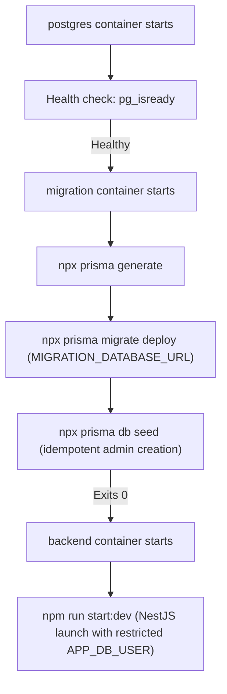

# Database Setup & Architecture Guide

## 1. Overview & Technology Stack

- **RDBMS:** PostgreSQL 16 on **Debian Bookworm** (`postgres:16-bookworm`).
- **ORM / Migrations:** Prisma 5.22.x with committed SQL migrations.
- **Backend Runtime:** Node.js 22.23.3 on **Debian Bookworm** (`node:22.23.3-bookworm-slim`).
- **Framework:** NestJS 10 with global `DatabaseModule` and injectable `PrismaService`.
- **Password Hashing:** Argon2id via `argon2` npm package.

---

## 2. Role Separation & Security Architecture

Following project security standards, database roles are strictly separated:

| Role | Environment Variable | Responsibilities | Privileges |
| :--- | :--- | :--- | :--- |
| **Database Owner** | `POSTGRES_USER` (`chess_owner`) | Running schema migrations, DDL execution, seed bootstrap | Superuser / schema owner (`CREATE TABLE`, `DROP`, `ALTER`) |
| **Application User** | `APP_DB_USER` (`chess_app`) | Handling runtime NestJS REST & WebSocket queries | Restricted CRUD (`SELECT`, `INSERT`, `UPDATE`, `DELETE`) |

### Role Initialization (`01-init-roles.sh`)

When the PostgreSQL data volume (`db_data`) is initialized for the first time:

1. Docker executes `backend/prisma/init-db/01-init-roles.sh`.
2. It creates role `APP_DB_USER` with `APP_DB_PASSWORD`.
3. Grants `CONNECT` on `POSTGRES_DB` and `USAGE` on schema `public`.
4. Configures `ALTER DEFAULT PRIVILEGES` so that all future tables and sequences created by `POSTGRES_USER` during migrations automatically grant CRUD access to `APP_DB_USER`.

---

## 3. Database Schema Contract

### User (`users`)

- **`id`**: UUID primary key (`@default(uuid())`).
- **`email`**: Unique lowercase canonical email, ASCII validation, `"C"` collation.
- **`username`**: Unique handle `^[a-z0-9_]{3,20}$`, `"C"` collation.
- **`rating`**: ELO rating, defaults to `1200`.
- **`password_hash`**: Argon2id encoded string.
- **`role`**: User authorization level: `'user'` (default) or `'admin'`.
- **`status`**: Presence indicator: `'offline'` (default), `'online'`, `'in_game'`.
- **`created_at` / `updated_at`**: Timestamps in `TIMESTAMPTZ(3)`.

### Session (`sessions`)

- **`id`**: UUID primary key.
- **`user_id`**: Foreign key to `users.id` with `ON DELETE CASCADE`.
- **`token_hash`**: SHA-256 hex digest of the bearer token, `"C"` collation, check `^[0-9a-f]{64}$`.
- **`created_at` / `expires_at`**: `TIMESTAMPTZ(3)`, enforced check `expires_at > created_at`.

### Game (`games`)

- **`id`**: UUID primary key.
- **`white_id` / `black_id`**: Foreign keys to `users.id` with `ON DELETE SET NULL` (preserves historical match logs).
- **`result`**: `'WHITE_WON'`, `'BLACK_WON'`, `'DRAW'`, `'IN_PROGRESS'`, `'ABORTED'`.
- **`end_reason`**: Match conclusion reason (`'CHECKMATE'`, `'RESIGNATION'`, `'TIMEOUT'`, etc.).
- **`time_control`**: Match timing format (e.g. `'rapid_10_0'`, `'blitz_5_3'`).
- **`white_rating` / `black_rating`**: Initial ELO ratings.
- **`white_rating_change` / `black_rating_change`**: Rating deltas applied after completion.
- **`pgn`**: Full game PGN notation string.
- **`game_start` / `game_end`**: Timestamps with check `game_end IS NULL OR game_end >= game_start`.
- **`tournament_id` / `tournament_match_id`**: Foreign keys to `tournaments.id` and `tournament_matches.id` with `ON DELETE SET NULL` (links tournament matches to full game history and moves). Both are set together, to ids of the same tournament, by the tournament service (not a CHECK, because both FKs are nulled one at a time on delete). A match can have several games (regular game plus tiebreaks); the partial unique index `games_tournament_match_active_key` allows at most one `IN_PROGRESS` game per match. Prisma cannot model partial indexes, so this index exists only in the migration SQL.

### Game Moves (`game_moves`)

- **`id`**: UUID primary key.
- **`game_id`**: Foreign key to `games.id` with `ON DELETE CASCADE`.
- **`ply`**: Sequential half-move counter (1 = White move 1, 2 = Black move 1, 3 = White move 2, etc.; check `ply >= 1`).
- **`move_number`**: Full move number (1, 1, 2, 2, 3, 3...; check `move_number >= 1`).
- **`color`**: `'WHITE'` or `'BLACK'`.
- **`played_by_id`**: Foreign key to `users.id` with `ON DELETE SET NULL` (nullable for AI moves).
- **`san`**: Standard Algebraic Notation (e.g. `'e4'`, `'Nf3'`, `'O-O'`, `'e8=Q#'`), `"C"` collation.
- **`uci`**: Universal Chess Interface notation (e.g. `'e2e4'`), `"C"` collation.
- **`fen_after`**: FEN board state representation after this move.
- **`time_spent_ms` / `time_remaining_ms`**: Clock timing tracking.
- **Unique Constraint**: `(game_id, ply)` guarantees strict move sequencing per match.

### Tournament (`tournaments`)

- **`id`**: UUID primary key.
- **`title`**: Tournament name (3–64 characters after trimming).
- **`description`**: Optional tournament description (max 255 characters).
- **`creator_id`**: Foreign key to `users.id` (`ON DELETE RESTRICT`).
- **`max_participants`**: Capacity constrained to powers of 2: `2, 4, 8, 16, 32`.
- **`current_participants`**: Number of currently registered players (enforced bound: `0 <= current <= max`).
- **`status`**: `'OPEN_FOR_SIGNUP'`, `'REGISTRATION_CLOSED'`, `'IN_PROGRESS'`, `'FINISHED'`, `'CANCELLED'`.
- **`registration_deadline`**: `TIMESTAMPTZ(3)` cutoff for player registrations.
- **`started_at` / `completed_at`**: Lifecycle timestamps (check `completed_at >= started_at` when both are set).
- **`champion_id`**: Foreign key to `users.id` (`ON DELETE SET NULL`), populated on completion.

### Tournament Participant (`tournament_participants`)

- **`id`**: UUID primary key.
- **`tournament_id`**: Foreign key to `tournaments.id` (`ON DELETE CASCADE`).
- **`user_id`**: Foreign key to `users.id` (`ON DELETE CASCADE`).
- **`seed`**: Integer seed assignment (1..N; check `seed >= 1`). Unique per tournament (`NULL` = not yet seeded).
- **`seed_rating`**: Frozen snapshot of `users.rating` taken when registration closes; seeding and bracket display use this, never live `users.rating`.
- **`final_rank`**: Final placement (1 = Champion, 2 = Runner-up, etc.; check `final_rank >= 1`). Not unique: both losing semifinalists share rank 3.
- **`registered_at`**: Timestamp of sign-up.
- **Unique Constraint**: `(tournament_id, user_id)` prevents duplicate registrations.

### Tournament Match (`tournament_matches`)

- **`id`**: UUID primary key.
- **`tournament_id`**: Foreign key to `tournaments.id` (`ON DELETE CASCADE`).
- **`round` / `match_index`**: Round number (`>= 1`) and match index within the round (`>= 0`).
- **`identifier`**: Readable match label (e.g., `'R1-M1'`, `'R2-M1'`).
- **`player1_id` / `player2_id`**: Foreign keys to `users.id` (`ON DELETE SET NULL`); check that they differ when both are set.
- **`winner_id`**: Foreign key to `users.id` (`ON DELETE SET NULL`).
- **`status`**: `'PENDING'`, `'SCHEDULED'`, `'IN_PROGRESS'`, `'COMPLETED'`, `'WALKOVER'`.
- **`is_bye`**: Boolean flag indicating automatic bye advance.
- **`next_match_id` / `next_match_slot`**: Self-referencing foreign key (`ON DELETE SET NULL`) to the match the winner advances to, and the target slot (`'player1'` or `'player2'`). This is the only stored bracket edge; the matches feeding a given match are found with `WHERE next_match_id = <id>`.
- **Service-enforced invariants** (not CHECKs, because the referenced user columns use `ON DELETE SET NULL` and Postgres applies each SET NULL as a separate row update): `winner_id` is one of the two players; `next_match_id` and `next_match_slot` are set together.
- **Unique Constraint**: `(tournament_id, round, match_index)`.

### Tournament Invitation (`tournament_invitations`)

- **`id`**: UUID primary key.
- **`tournament_id`**: Foreign key to `tournaments.id` (`ON DELETE CASCADE`).
- **`sender_id`**: Foreign key to `users.id` (`ON DELETE CASCADE`).
- **`recipient_id`**: Foreign key to `users.id` (`ON DELETE CASCADE`).
- **`status`**: `'PENDING'`, `'ACCEPTED'`, `'DECLINED'`, `'EXPIRED'`.
- **`created_at` / `expires_at`**: Timestamps with check `expires_at > created_at`.
- **Check**: `sender_id <> recipient_id`.
- **Unique Constraint**: `(tournament_id, recipient_id)`. Re-inviting a user who declined or whose invitation expired must update the existing row (upsert), not insert a new one.

---

## 4. Container Startup & Migration Lifecycle

When running `docker compose up --build` or `make up`:



1. **`postgres`** starts and checks readiness via `pg_isready`.
2. **`migration`** starts once `postgres` is healthy:
   - Receives owner credentials (`MIGRATION_DATABASE_URL`).
   - Generates Prisma client bindings (`npx prisma generate`).
   - Applies unapplied migrations (`npx prisma migrate deploy`).
   - Runs idempotent seeding (`npx prisma db seed`).
   - Completes successfully and exits.
3. **`backend`** starts once `migration` completes successfully:
   - Receives only runtime application credentials (`DATABASE_URL`).
   - Uses Prisma client bindings generated during the Docker image build.
   - Starts the NestJS server without access to database-owner credentials.

---

## 5. Admin Bootstrap Seeding

Initial admin credentials can be set in `.env`:

```dotenv
ADMIN_EMAIL=admin@transcendence.local
ADMIN_USERNAME=admin
ADMIN_PASSWORD=replace-with-secure-admin-password
```

On startup, `backend/prisma/seed.ts`:

- Checks if a user with `ADMIN_EMAIL` or `ADMIN_USERNAME` already exists.
- If missing, securely hashes `ADMIN_PASSWORD` using Argon2id and creates the user with `role: 'admin'`.
- If `ADMIN_PASSWORD` is absent or empty, skips bootstrap entirely. The example environment leaves it empty.
- Preserves the password exactly, including spaces. Requires 15–128 Unicode characters, valid Unicode and at most 512 UTF-8 bytes, matching registration.
- Skips insertion only when both identifiers match an existing admin; its current password is retained.
- Fails startup on any other identity collision; existing ordinary users are never promoted.

---

## 6. Volume Management & Persistence

- **Data Persistence:** Database files are stored in the Docker named volume `db_data`. They persist across `docker compose down` and system reboots.
- **Resetting Database (Destructive):**
  To perform a complete clean reset (erasing all accounts, matches, and tables):

  ```bash
  make clean
  # or: docker compose down -v
  ```

  On the subsequent `make up`, PostgreSQL will re-run the role initialization script and the migration service will recreate tables and the admin account from scratch.

## 7. Running verification

Use Node.js 22 (the Docker image pins 22.23.3). From `backend`, run `npm ci`, `npm run prisma:generate`,
`npm run test:bootstrap`, and `npm run build`. Bootstrap unit tests need no database.

Database tests require a **separate disposable database**, with a name ending in
`_test` (for example `chess_test`). Provision it using the same owner/application
role separation and grants as the application database. Apply migrations to that
database using the owner URL:

```bash
DATABASE_URL='<owner URL for chess_test>' npm run prisma:migrate:deploy
TEST_DATABASE_URL='<application-role URL for chess_test>' npm run test:db
```

`test:db` never falls back to `DATABASE_URL`. Do not point it at a database containing
real users or games. It creates its own user fixture and does not require admin
seeding. The DDL permission check rolls back even when permissions are incorrect.
Other tests clean up on success; if a test fails, fixture records can remain in the
disposable database. Never use owner credentials for `TEST_DATABASE_URL`.

## Integration with authentication

This folder combines the database implementation with the existing authentication
backend. Admin bootstrap reuses the authentication password validation policy.
`main.ts`, `configure-app.ts`, Nginx configuration, auth dependencies and
auth tests are retained. Docker generates Prisma bindings at build time and runs
migrations/seeding in a separate owner-credential service. The backend connects
using the restricted application role.

The `AuthRepository` binding uses `PrismaAuthRepository` and the shared PrismaService.
The adapter provides account persistence, atomic session rotation and bounded cleanup. `npm test` tests authentication without PostgreSQL;
`npm run test:bootstrap` tests seed policies and the database URL guard;
`npm run test:db` and `npm run test:auth:db` require the isolated database described above.
See [auth testing](auth-testing.md) for commands and the manual browser checklist.

For local backend startup, provide `DATABASE_URL` in the process environment.
The root `.env` is used by Docker Compose; it is not automatically loaded by Nest.
Copy any missing values from `.env.example` into your local configuration and set
real database secrets. URL-encode passwords in connection URLs.
