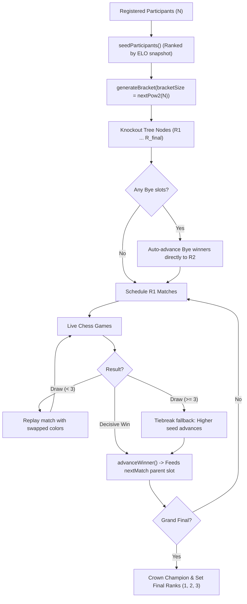

# Tournament Bracket & Progression Engine

- **Module Classification:** 42 Transcendence — IV.6 Gaming and user experience, Minor: Tournament System (1 Point)
- **Author:** Tomasz Szymański (`tszymans`)
- **Status:** Implemented & Verified in Draft PR #160 (`tszyman/issue68-tournament-bracket-engine`)

---

## 1. Overview & Architecture

The Tournament Bracket Engine is responsible for the competitive lifecycle of single-elimination knockout tournaments in `ft_transcendence`. 
It provides:
1. **Pure Mathematical Topology & Seeding (`bracket-generator.ts`)**: Decoupled, zero-I/O bracket calculations for powers of 2 ($2, 4, 8, 16, 32$).
2. **Balanced Seed-Fold Matching**: Prevents top seeds from meeting until the final stages (Seed 1 and Seed 2 can only meet in the Grand Final).
3. **Automatic Round 1 Bye Resolution**: When participant count $N < \text{bracketSize}$, missing slots are assigned as Byes to top seeds and auto-advanced to Round 2.
4. **Database-Integrated Progression Service (`TournamentBracketService`)**: Executes match progressions, crowns champions, assigns final rankings, and manages knockout draw replays inside PostgreSQL transactions.



---

## 2. Seeding & Bracket Topology Rules

### Balanced Seed Folding Algorithm
For any round with $K$ matches, Round 1 seeds Match $m$ ($0$-indexed) as:
- **Player 1:** Seed $m + 1$
- **Player 2:** Seed $\text{bracketSize} - m$

Between rounds, Match $i$ (top) and Match $K - 1 - i$ (bottom) feed into the next round's Match $i$:
- `topMatch.nextMatchId = targetMatch.id`, `nextMatchSlot = 'player1'`
- `bottomMatch.nextMatchId = targetMatch.id`, `nextMatchSlot = 'player2'`

### Example Topologies:
* **4-Player Bracket (2 Rounds):**
  - `R1-M1`: Seed 1 vs Seed 4 $\to$ feeds `Final.player1`
  - `R1-M2`: Seed 2 vs Seed 3 $\to$ feeds `Final.player2`
* **8-Player Bracket (3 Rounds):**
  - `R1-M1`: Seed 1 vs Seed 8 $\to$ feeds `SF1.player1`
  - `R1-M2`: Seed 2 vs Seed 7 $\to$ feeds `SF2.player1`
  - `R1-M3`: Seed 3 vs Seed 6 $\to$ feeds `SF2.player2`
  - `R1-M4`: Seed 4 vs Seed 5 $\to$ feeds `SF1.player2`
  - `SF1` (Winner 1v8 vs Winner 4v5) and `SF2` (Winner 2v7 vs Winner 3v6) feed into the Grand Final.

### Automatic Round 1 Bye Handling
When $N < \text{bracketSize}$ (e.g. 6 players in an 8-slot bracket):
- Seeds 7 and 8 are absent.
- `R1-M1` (Seed 1 vs 8) and `R1-M2` (Seed 2 vs 7) are marked `isBye = true` and `status = 'COMPLETED'`.
- Seeds 1 and 2 are automatically placed into their Round 2 Semifinal slots as `player1`.
- Matches `R1-M3` (3 vs 6) and `R1-M4` (4 vs 5) remain active games (`status = 'SCHEDULED'`).

---

## 3. Match Progression & Knockout Draw Rules

### 1. `advanceWinner(tx, tournamentId, matchId, winnerId)`
- Marks current match `COMPLETED` with `winnerId`.
- Propagates `winnerId` into `nextMatchId` at `nextMatchSlot` (`player1` or `player2`).
- If the other slot in `nextMatch` is already populated, transitions `nextMatch.status = 'SCHEDULED'`.
- If concluding the Grand Final:
  - Updates tournament status to `FINISHED` and records `championId = winnerId`.
  - Sets final ranks: Champion $= 1$, Runner-up $= 2$, Semifinalists $= 3$.

### 2. Knockout Draw & Tiebreak Protocol (`handleMatchDraw`)
In a single-elimination bracket, draws cannot leave a match unresolved:
- **Games 1 & 2 Drawn:** The engine triggers an immediate rematch with piece colors swapped. The match remains `IN_PROGRESS`.
- **Game 3 Drawn (Replay Cap):** Core tiebreak fallback activates: the participant with the better seed (lower seed number) is declared the winner and advanced to the next round.
- Respects the PostgreSQL partial unique index `games_tournament_match_active_key`: allows multiple games per tournament match in history, but enforces at most one `IN_PROGRESS` game at any time.

### 3. Walkover / Forfeit Protocol (`handleWalkover`)
If a participant forfeits or fails to appear:
- The match is marked `status = 'WALKOVER'`.
- The opposing player is declared the winner and immediately advanced through the bracket.

---

## 4. Developer Verification & Test Suites

All tests run inside the Docker container to ensure environment consistency:

```bash
# 1. Run pure mathematical bracket generator tests (10 test cases):
docker compose run --rm backend npm run test:tournament-bracket

# 2. Run database-integrated bracket service tests (4 test cases):
docker compose run --rm backend npm run test:tournament-bracket:service

# 3. Run full backend regression suite (39 test cases):
docker compose run --rm backend npm test

# 4. Verify Docker build:
docker compose build backend
```
